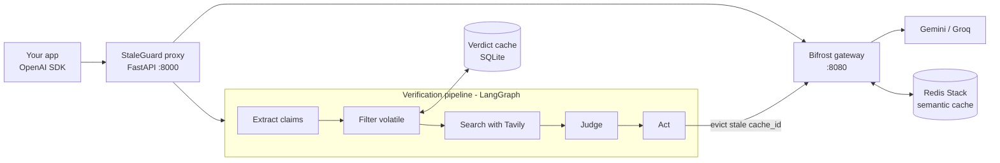

# StaleGuard

> **Semantic caching makes LLM apps cheap. It also makes them stale.**
> StaleGuard sits in front of the [Bifrost](https://github.com/maximhq/bifrost) LLM gateway. It finds the time-sensitive claims in an answer, checks them against the live web with [Tavily](https://tavily.com), corrects or blocks the answer with citations, and evicts the stale entry from Bifrost's semantic cache so it is never served again.

Built for the **Global AI Hackathon (Geek Room × HackCulture)**. The problem statement is *Open-Source Bifrost Gateway*, with the Tavily *Stale-Answer Detector* integration. Submission deadline: **15 Nov 2026, 11:59 PM IST**.

---

## Contents

1. [Where the project stands](#1-where-the-project-stands-read-this-first)
2. [The problem](#2-the-problem)
3. [How it works](#3-how-it-works)
4. [Setup: run it yourself](#4-setup-run-it-yourself)
5. [Using it](#5-using-it)
6. [API reference](#6-api-reference)
7. [Configuration](#7-configuration)
8. [Repository tour](#8-repository-tour)
9. [Tests](#9-tests)
10. [Evaluation](#10-evaluation)
11. [Design decisions and what we learned](#11-design-decisions-and-what-we-learned)
12. [Known limitations](#12-known-limitations)
13. [What's next and how to help](#13-whats-next-and-how-to-help)
14. [Working rules for this repo](#14-working-rules-for-this-repo)

---

## 1. Where the project stands (read this first)

**`SPEC.md` is the source of truth** for scope, architecture and build order. The build order has 8 steps (SPEC §9). After each step the repo runs end to end, and each step is its own commit.

| Step | What | Status |
|---|---|---|
| 1 | Scaffold: docker-compose (Bifrost + Redis), config, `.env.example`, health check | ✅ Done |
| 2 | Transparent proxy: StaleGuard → Bifrost passthrough, cache-key forwarding, read cache metadata | ✅ Done |
| 3 | `/verify` endpoint: extract → filter → verify → judge pipeline (LangGraph), annotate mode | ✅ Done |
| 4 | Verdict cache (SQLite, per-class TTL) and fast path for static answers | ✅ Done |
| 5 | Pipeline wired into the proxy; `rewrite` and `block` modes; Bifrost cache eviction; cross-provider failover | ✅ Done |
| 6 | Eval scaffold: dataset format, runner, metrics, verify-every-claim baseline | ✅ Done; **dataset still needs real rows** |
| 7 | Streamlit demo UI | ✅ Done |
| 8 | Final README, eval results and chart, demo video | 🟡 This README is the first version. Eval numbers come after the dataset is filled in. |

**What works today, verified live:**
- An app calls StaleGuard exactly as it would call OpenAI. StaleGuard forwards the call to Bifrost, gets the answer, and verifies it before returning it.
- **Headline flow:** a stale answer sits in Bifrost's semantic cache. A user asks a *paraphrase* of the question, and Bifrost serves the cached answer (semantic hit, similarity 0.97). StaleGuard flags the claim as stale with dated sources and evicts the entry; the next request gets a fresh answer.
- **Correction from current sources:**

  | Claim in the answer | StaleGuard's correction | Source |
  |---|---|---|
  | "latest Python is 3.12" | 3.15 | devguide.python.org |
  | "Node 20 is the current LTS" | flagged as end-of-life | nodesource.com |
  | "GPT-4o is OpenAI's newest" | flagged as superseded | openai.com |

- **No false alarm on historical facts:** "Python 3.12 was released in Oct 2023" stays CURRENT.
- **Static answers take the fast path:** "Canberra is the capital of Australia" triggers 0 web searches.
- 140 unit tests pass, with all external calls mocked.

**Open items:** see [§13](#13-whats-next-and-how-to-help). The most important one is filling in the eval dataset.

---

## 2. The problem

An answer is **stale** when it contains a *time-sensitive claim* that contradicts *current, authoritative* web evidence. Staleness comes from three places:

1. **Training cutoff.** The model confidently states an old fact ("the latest Python is 3.12").
2. **Cached responses.** A gateway's semantic cache serves an answer that was right last month. Caching is exactly what makes gateways like Bifrost cheap, and also what makes them serve old facts.
3. **Old RAG documents.** The retrieved document has been superseded.

StaleGuard handles all three; the demo focuses on #1 and #2.

Not every claim needs checking. "Water boils at 100 °C" never changes, while prices change daily. StaleGuard sorts each claim into a **volatility class**. Each class decides whether the claim is checked at all and how long a verdict stays valid:

| Class | Example | A verdict stays valid for |
|---|---|---|
| `price` | "GPT-4o costs $5 per million input tokens" | 1 day |
| `event_status` | "The merger is pending" | 1 day |
| `relative_time` | anything with "latest / current / now / this year" | 1 day |
| `version` | "The latest Python is 3.12" | 7 days |
| `policy` | "The EU AI Act requires…" | 14 days |
| `role` | "X is the CEO of Y" | 30 days |
| `statistic` | "India's population is 1.42B" | 30 days |
| `static` | "Water boils at 100 °C" | never checked |

---

## 3. How it works



### One request, step by step

1. **Your app points its OpenAI SDK at StaleGuard** (`base_url="http://localhost:8000/v1"`). Nothing else changes.
2. **StaleGuard forwards the request to Bifrost.** Bifrost either answers from its semantic cache or calls the model, and reports which one it did (`extra_fields.cache_debug`: `cache_hit`, `hit_type`, `similarity`, `cache_id`).
3. **The verification pipeline runs on the answer** (`src/staleguard/pipeline/`):

   | Stage | File | What it does | Model / service |
   |---|---|---|---|
   | **Extract** | `extract.py` | Splits the answer into atomic, self-contained claims. For each claim it also writes a *neutral search query* ("latest stable Python version", without the claimed value). | Small model (Gemini Flash-Lite) |
   | **Filter** | `classify.py` | Puts each claim in a volatility class. Regex rules run first (years, "latest", "$", "CEO", version numbers); the small model handles the rest. `static` claims are dropped. If nothing volatile is left, the answer is returned straight away (**fast path**). At most 5 claims are checked, most volatile first. | Rules + small model |
   | **Verdict cache** | `verdict_cache.py` | A claim judged recently (within its class TTL) reuses that verdict, with no search and no judge call. | SQLite |
   | **Verify** | `verify.py` | One Tavily search per claim, run in parallel. Claims about *now* get the current year added to the query and a one-year recency filter; claims that name a year (historical facts) don't. Evidence is sorted newest first. | Tavily |
   | **Judge** | `judge.py` | One batched call that gives every claim a verdict: `CURRENT`, `STALE` (with a `corrected_claim`), `CONFLICTING` or `UNVERIFIABLE`, plus confidence and cited evidence. **Code enforces the evidence rule:** a verdict without valid citations is downgraded to `UNVERIFIABLE`, never `STALE`. | Judge model (Groq gpt-oss-120b) |
   | **Act** | `act.py`, `guard.py` | Applies the mode chosen for the request (below) and evicts stale cache entries. | Judge model for rewrite |

4. **Act**, chosen per request with the `x-sg-mode` header:
   - `annotate` (default): the answer is returned unchanged, with a `staleguard` report attached.
   - `rewrite`: the answer is regenerated with the corrected facts and numbered citations. The original is kept in the report.
   - `block`: the answer is replaced with a short refusal that lists the corrections and sources. No LLM call.

   `rewrite` and `block` only act on a STALE claim that has a correction and confidence ≥ 0.7.
5. **Cache eviction** (the headline integration): if any claim is STALE, StaleGuard deletes that answer's `cache_id` from Bifrost's cache (`DELETE /api/cache/clear/{cacheId}`). This happens on a cache **hit**, so the stale entry stops being served. It also happens on a cache **miss**, because Bifrost has just cached the new stale answer.
6. **Fail open:** if verification fails (a provider down, a search timing out), your app still gets the model's answer, marked `skipped`, with an `x-staleguard-error` header. StaleGuard never makes an app worse than it was without it.

### Why Bifrost matters here
- **Model tiering through one gateway:** a cheap model does extract and filter, and a stronger model judges. Both go through Bifrost.
- **Cross-provider failover:** every internal call carries Bifrost `fallbacks` (Groq 120b → Groq 20b → Gemini). When the judge model hits its rate limit, Bifrost moves to the next model on its own, and the report records which model actually answered (`models_by_stage`).
- **The semantic cache is both the villain and the hero.** It cuts cost, and StaleGuard makes it safe by evicting what has gone stale.

---

## 4. Setup: run it yourself

### Prerequisites
- **Docker Desktop** (runs Bifrost and Redis).
- **[uv](https://docs.astral.sh/uv/)**, the Python package manager. It installs Python 3.11 for you.
- **Git**.
- Three **free API keys**:

  | Key | Where to get it | Used for |
  |---|---|---|
  | `GEMINI_API_KEY` | https://aistudio.google.com/apikey | Small model (extract/classify) and cache embeddings |
  | `GROQ_API_KEY` | https://console.groq.com/keys | Judge model |
  | `TAVILY_API_KEY` | https://app.tavily.com | Web search (free tier: 1,000 credits/month) |

### Steps

```bash
git clone https://github.com/bhadrakorukonda/Global-AI-hackathon.git
cd Global-AI-hackathon

# 1. Secrets: copy the template and fill in the three keys + a setup token
cp .env.example .env
#    BIFROST_SETUP_TOKEN can be any random string:
python -c "import secrets; print(secrets.token_hex(16))"

# 2. Start Bifrost (gateway) and Redis Stack (semantic-cache vector store)
docker compose up -d
#    Bifrost's dashboard is then at http://localhost:8080

# 3. Install Python dependencies (creates .venv)
uv sync

# 4. Start StaleGuard
uv run uvicorn staleguard.main:app --port 8000

# 5. Check that everything is connected
curl http://localhost:8000/health
#    -> {"status":"ok", ..., "bifrost":{"ok":true, ...}}
```

**If port 8080 is already in use** (it was on the original dev machine), set `BIFROST_HOST_PORT=8081` and `BIFROST_URL=http://localhost:8081` in `.env`, then run `docker compose up -d` again.

**Windows note:** if `uv` isn't on your PATH after installing with winget, it is at `%LOCALAPPDATA%\Microsoft\WinGet\Links\uv.exe`. Model output sometimes contains characters the Windows console can't print; the scripts already switch stdout to UTF-8.

---

## 5. Using it

### Demo UI (easiest)

```bash
uv run streamlit run demo/app.py        # needs Bifrost + StaleGuard running (steps 2 and 4 above)
```

- Ask anything in the chat box. Each question is **one** call through StaleGuard.
  - **Left pane:** what the model, or Bifrost's cache, said.
  - **Right pane:** what StaleGuard returned to the app.
  - **Below:** one card per claim, colored by verdict, with the correction and dated source links. A "cost of this check" footer shows added latency, Tavily searches, tokens per stage, and which models answered.
- The sidebar sets the mode (annotate / rewrite / block), the answering model, whether to use Bifrost's semantic cache, and trusted domains.
- The sidebar's **demo script** buttons:
  1. **Stale from training data:** asks for the latest Python version.
  2. **Stale from cache:** stores an answer in Bifrost's cache directly, bypassing StaleGuard (standing in for "an answer cached last month"). It then asks a paraphrase through StaleGuard: a semantic cache hit, flagged STALE and evicted.
  - **2b. Ask again:** shows the next request no longer gets the stale cached answer.
  3. **No false alarm:** a static question goes through the fast path with zero searches.

### From code (any OpenAI-compatible client)

```python
from openai import OpenAI

client = OpenAI(base_url="http://localhost:8000/v1", api_key="unused")  # provider keys live in Bifrost
resp = client.chat.completions.create(
    model="gemini/gemini-3.5-flash-lite",           # <bifrost-provider>/<model>
    messages=[{"role": "user", "content": "What is the latest stable version of Python?"}],
    extra_headers={
        "x-sg-mode": "rewrite",                     # annotate | rewrite | block
        "x-bf-cache-key": "my-app",                 # opt in to Bifrost's semantic cache
    },
)
print(resp.choices[0].message.content)
print(resp.model_extra["staleguard"]["verdict_summary"])   # clean | stale | unverified
```

### Verify any text (no chat call), e.g. RAG output

```bash
curl -X POST http://localhost:8000/verify -H "content-type: application/json" \
  -d '{"text": "The latest stable version of Python is 3.12.", "question": "Latest Python?"}'
```

### Smoke scripts (live end-to-end checks; they spend a few API credits)

| Script | Checks |
|---|---|
| `scripts/smoke_chat.py` | A plain chat call through Bifrost works. |
| `scripts/smoke_proxy.py` | The proxy passes through correctly: cache miss → direct hit → semantic hit, and streaming. |
| `scripts/smoke_verify.py` | `/verify` on sample answers. Run it twice to see verdict-cache hits. |
| `scripts/smoke_guard.py` | **The headline flow:** seed the cache → paraphrase hit → STALE → eviction confirmed → rewrite → block. |

Run each with `uv run python scripts/<name>.py`, while StaleGuard is running.

---

## 6. API reference

| Endpoint | Purpose |
|---|---|
| `POST /v1/chat/completions` | OpenAI-compatible proxy with verification. With `stream: true` the response is passed through **unverified** and marked `skipped`. |
| `POST /verify` | Body: `{"text": ..., "question"?: ..., "include_domains"?: [...]}`. Returns the report for any text. |
| `GET /health` | StaleGuard's status and whether it can reach Bifrost. |

**Request headers**

| Header | Meaning |
|---|---|
| `x-sg-mode` | `annotate` (default) / `rewrite` / `block`. |
| `x-sg-include-domains` | A comma-separated list of trusted domains for Tavily to prefer, e.g. `python.org,nodejs.org`. |
| `x-bf-cache-key` | Passed to Bifrost; it turns on the semantic cache for this request. Other `x-bf-*` headers are passed through too. |

**Response headers:** `x-staleguard-status` (`clean` / `stale` / `unverified` / `skipped`), `x-staleguard-claims-checked`, `x-staleguard-action` (`none` / `rewritten` / `blocked`), `x-staleguard-cache-evicted`, `x-staleguard-error` (only when something failed open).

**Response body:** the normal OpenAI response plus a top-level `staleguard` object:

```jsonc
{
  "verdict_summary": "stale",
  "claims": [{
    "claim": {"text": "The latest stable version of Python is 3.12.", "claim_class": "version"},
    "verdict": "STALE",
    "corrected_claim": "The latest stable version of Python is 3.15.",
    "confidence": 0.93,
    "evidence": [{"url": "https://devguide.python.org/versions/", "title": "...", "published_date": "2026-10-07"}],
    "from_cache": false
  }],
  "claims_extracted": 3, "claims_checked": 1,
  "latency_ms": 7100,                         // time StaleGuard added
  "tokens_by_stage": {"extract": 850, "classify": 270, "judge": 1600},
  "models_by_stage": {"judge": "groq/openai/gpt-oss-120b"},   // shows failover when it happens
  "tavily_calls": 1, "verdict_cache_hits": 0,
  "mode": "annotate", "action": "none", "original_answer": null,
  "bifrost_cache_hit": true, "cache_evicted": true, "evicted_cache_id": "eff7f451-..."
}
```

---

## 7. Configuration

All settings come from `.env` (template: `.env.example`). **Never commit `.env`.**

| Variable | Default | Meaning |
|---|---|---|
| `GEMINI_API_KEY`, `GROQ_API_KEY` | (none) | Read by Bifrost (docker-compose passes `.env` into the container). |
| `BIFROST_SETUP_TOKEN` | (none) | Any random string. Required on Bifrost's `/api/*` calls, including cache eviction. |
| `TAVILY_API_KEY` | (none) | Without it, verification is off and the proxy only passes requests through. |
| `BIFROST_URL` / `BIFROST_HOST_PORT` | `http://localhost:8080` / `8080` | Change both if port 8080 is taken. |
| `SMALL_MODEL` | `gemini/gemini-3.5-flash-lite` | Extract and classify. |
| `JUDGE_MODEL` | `groq/openai/gpt-oss-120b` | Judge and rewrite. |
| `SMALL_MODEL_FALLBACKS`, `JUDGE_MODEL_FALLBACKS` | see `.env.example` | JSON lists; Bifrost tries them in order when the primary model fails. |
| `MAX_CLAIMS_PER_ANSWER` | `5` | Most volatile claims checked per answer (caps latency and credits). |
| `VERDICT_CACHE_ENABLED` / `VERDICT_CACHE_PATH` | `true` / `data/verdicts.sqlite3` | The SQLite verdict cache. |
| `DEFAULT_MODE` | `annotate` | Used when a request has no `x-sg-mode` header. |
| `STALE_CONFIDENCE_THRESHOLD` | `0.7` | Minimum judge confidence before rewrite/block acts. |

Bifrost's own configuration (providers, retries, the semantic-cache plugin with Redis, Gemini embeddings, 24h TTL, similarity threshold 0.8) is in `bifrost/config.json`.

---

## 8. Repository tour

```
README.md                 you are here
SPEC.md                   source of truth: scope, architecture, build order, decisions
CLAUDE.md                 working rules for the AI coding assistant (also good rules for humans)
docs/bifrost-notes.md     every Bifrost/Tavily behaviour we rely on, checked against docs/source and tested live
docker-compose.yml        Bifrost (pinned v2.4.0) + Redis Stack
bifrost/config.json       providers (Gemini, Groq), retries, semantic-cache plugin
.env.example              template for .env

src/staleguard/
  main.py                 FastAPI app: routes only (/health, /verify, /v1/chat/completions)
  guard.py                proxy service: forward → verify → act → evict; response headers
  bifrost_client.py       HTTP to Bifrost: forward chat, stream, health, cache eviction
  factory.py              builds the pipeline from settings (shared by API and eval)
  config.py               settings (pydantic-settings, reads .env)
  schemas.py              every Pydantic model: Claim, Evidence, ClaimVerdict, Report, LLM outputs…
  llm.py                  OpenAI-SDK backend via Bifrost, structured-JSON calls with one retry, token tracking
  verdict_cache.py        SQLite verdict cache with per-class TTL
  evaluation.py           eval dataset loading, scoring and metrics
  pipeline/
    graph.py              LangGraph wiring of the stages
    extract.py  classify.py  verify.py  judge.py  act.py
  prompts/*.md            all LLM prompts (versioned in a header comment), never inline strings

demo/app.py               Streamlit UI (thin client of the running proxy)
demo/guard_view.py        demo's HTTP calls + response parsing (unit-tested)
eval/                     dataset, runner, README with the dataset rules
scripts/                  live smoke tests (see §5)
tests/                    pytest suite; fakes.py + fixtures/ hold recorded Bifrost/Tavily responses
```

**Layering rule:** `main.py` handles HTTP only. Business logic lives in `guard.py` and `pipeline/`. All LLM calls go through `llm.py` to Bifrost, never directly to a provider.

---

## 9. Tests

```bash
uv run pytest -q          # 140 tests, ~3 s, no network: Tavily and LLM calls use fakes and recorded fixtures
```

Coverage includes:
- the classifier rules (`test_classify_rules.py`);
- verdict-cache TTL logic;
- the full pipeline with fakes, including the evidence rules and query policy;
- every proxy mode, eviction on cache hit and miss, and failing open (`test_guard.py`);
- eval metrics;
- the demo's response parsing.

---

## 10. Evaluation

The eval answers two questions:
1. Does StaleGuard catch stale answers without false alarms?
2. Does the volatility filter plus verdict cache save money compared with checking every claim?

Full details: [`eval/README.md`](eval/README.md).

- **Dataset** (`eval/dataset.jsonl`): about 50 hand-labeled answers.
  - About 25 are **stale** (real facts that changed in the last ~18 months, with the answer written as of before the change).
  - About 25 are **current**, including static and historical facts, to catch false alarms.
  - Every row has a source URL that **a person** checked.
- **Configs compared:**

  | Config | What it does |
  |---|---|
  | `verify_all` | Checks every claim (baseline). |
  | `guarded` | StaleGuard as shipped. |
  | `guarded_warm` | The same answers again, with the verdict cache warm. |

- **Metrics:** stale recall and precision, false-alarm rate, median added latency, tokens and Tavily credits per answer.
- **Run it:**

  ```bash
  uv run python eval/run_eval.py          # validates the dataset and prints a cost estimate; spends nothing
  uv run python eval/run_eval.py --yes    # full run: about 300 Tavily credits; writes eval/results/
  ```

**Status:** the runner works end to end; a smoke run on 3 example rows completed. **The dataset still needs real, verified rows**; see §13. The 6 example rows are marked `verified: false`, so the runner ignores them until someone checks them. Results go in this section after the full run.

---

## 11. Design decisions and what we learned

Full notes, with dates and evidence, are in [`docs/bifrost-notes.md`](docs/bifrost-notes.md) and SPEC.md.

- **Two LLM providers.** Gemini's free tier allows only 20 requests/day on Flash and gives no Pro access, so the judge runs on **Groq** (`gpt-oss-120b`). The small stages stay on Gemini Flash-Lite. Free-tier limits are per model, so splitting stages across models multiplies throughput, and a second provider makes failover real.
- **Redis Stack for the semantic cache**, not Weaviate. It is Bifrost's recommended store, needs one config field, and avoids a port clash. Cache TTL is 24h; the default of 5 minutes would expire mid-demo.
- **Search queries must not repeat the claim.** Searching "the latest Python is 3.12" returns pages that agree with 3.12. The extract step therefore writes a neutral query ("latest stable Python version") plus the current year and a recency filter. This was A/B-tested live and fixed 3 of 3 wrong corrections. Historical claims ("released in 2023") get no recency filter; with one, Tavily made up a 2026 release date.
- **Evidence rules are enforced in code, not trusted to the model.** No cited evidence means UNVERIFIABLE, never STALE.
- **The judge is fed a lean input.** Snippets are cut to 350 characters, sources are given as bare domains, the JSON is compact, and reasoning effort is low. Measured on identical evidence: 36% fewer judge tokens with the same verdicts. This matters because Groq's free tier allows 8K tokens/min.
- **Eviction also happens on cache misses.** Bifrost returns a `cache_id` on a miss too: the id of the entry it just wrote. Evicting it stops a fresh stale answer from being cached in the first place.
- **The verdict cache key** is a normalized word set of the claim, because the extractor words the same claim differently between runs.

---

## 12. Known limitations

- **Latency.** Verification adds about 7–25 s per answer on free tiers:
  - Even the static fast path costs two small-model calls in a row, about 8 s.
  - Groq's 8K tokens/min limit causes retries under load.
  - Merging extract and classify into one call would roughly halve the fast path; this is proposed, not done.
- **Corrections are only as good as the evidence each claim's search returns.** Example: "Node 20 is the current Active LTS" was correctly flagged as stale, but corrected to Node 24 rather than 26. That claim's own search returned only pages written before October's LTS switch. Letting the judge see evidence from all claims in the same answer would fix it; this is proposed, not done.
- **Streaming responses are not verified** (passed through and marked `skipped`).
- **Daily quotas.** A full eval run can use up Groq's 200K tokens/day on the 120b model. Bifrost then fails over to the 20b model, and the eval summary flags mixed judge models.

---

## 13. What's next and how to help

| # | Task | Who | Notes |
|---|---|---|---|
| 1 | **Fill in the eval dataset**: about 50 rows (25 stale, 25 current) in `eval/dataset.jsonl`. | Anyone (no code needed) | Follow the rules in `eval/README.md`. Find real facts that changed recently; open the official source; set `"verified": true` and `checked_on`. **Don't let an LLM write the ground truth.** The 6 example rows also need checking. |
| 2 | Run the full eval and commit `eval/results/` and a chart. | After #1 | Spends about 300 Tavily credits. Run on a fresh Groq quota day. |
| 3 | Decide on and implement the two latency/accuracy improvements in §12. | Dev | Architecture changes; agree on them first. |
| 4 | Final README pass: eval results, chart, demo GIF. | Dev | |
| 5 | Record a demo video of about 3 minutes, following the script in SPEC §7. | Anyone | Use the demo UI's sidebar buttons. The Python question gives the most reliable correction. |
| 6 | Slides: the problem (SPEC §2), the architecture, why Bifrost, the eval numbers. | Anyone | |

**Good first steps for a new teammate:**
1. Read §1–§3 of this README, then `SPEC.md`.
2. Follow §4 to run it locally.
3. Click through the demo UI's sidebar buttons.
4. Pick a task from the table above.

---

## 14. Working rules for this repo

- **Secrets only in `.env`**, which is gitignored. Never paste keys into code, issues or commits.
- **Every LLM call goes through Bifrost** via the `openai` SDK (`llm.py`); never call a provider directly.
- **Prompts live in `src/staleguard/prompts/*.md`**, never as inline strings. Bump the version comment when you change one.
- **LLM output that code depends on must be JSON**, validated with a Pydantic model and retried once on a parse failure.
- **Tests mock all network calls.** Run `uv run pytest -q` before every commit, and keep the repo runnable after every commit.
- **Before relying on Bifrost or Tavily behaviour**, check it against their docs or source and write the finding in `docs/bifrost-notes.md`.
- **Spending credits in bulk** (such as the full eval) and **architecture changes** are agreed with the team first.
- Stack: Python 3.11, `uv`, type hints everywhere, Pydantic v2.
