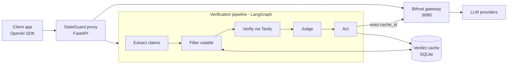

# StaleGuard — Build Spec

> Working name. Hackathon: Global AI Hackathon (Geek Room × HackCulture). Deadline **15 Nov 2026, 11:59 PM IST**.
> Primary problem statement: **Open-Source Bifrost Gateway**. Tavily integration checkbox: **Stale-Answer Detector**.

## 1. One-line pitch

**Semantic caching makes LLM apps cheap. It also makes them stale.** StaleGuard sits in front of the Bifrost gateway, catches time-sensitive claims that are out of date, verifies them live with Tavily, fixes the answer with citations, and evicts the stale entry from Bifrost's cache.

## 2. Problem definition (put this on slide 2)

An answer is **stale** when it contains a *time-sensitive claim* that contradicts *current, authoritative* web evidence.

Sources of staleness:
1. **Training cutoff.** The model confidently states an old fact.
2. **Cached responses.** A gateway semantic cache serves an answer that was right last month.
3. **Old RAG documents.** The retrieved doc was superseded.

StaleGuard targets all three, but the demo leans on #1 and #2.

Time-sensitive ("volatile") claim classes:
| Class | Example | Default re-verify TTL |
|---|---|---|
| `version` | "The latest Python is 3.12" | 7 days |
| `role` | "X is the CEO of Y" | 30 days |
| `price` | "GPT-4o costs $5/M input tokens" | 1 day |
| `statistic` | "India's population is 1.42B" | 30 days |
| `policy` | "The EU AI Act requires…", guidelines, regulations | 14 days |
| `event_status` | "The merger is pending" | 1 day |
| `relative_time` | anything with "latest / current / now / recently / this year" | 1 day |
| `static` | "Water boils at 100°C" | never verified |

## 3. Architecture



### Request flow
1. Client points `base_url` at StaleGuard (`http://localhost:8000/v1`). That's the only change needed: a drop-in, OpenAI-compatible proxy.
2. StaleGuard forwards `/v1/chat/completions` to Bifrost (`http://localhost:8080/v1/chat/completions`), passing through `x-bf-cache-key` so Bifrost's semantic cache applies.
3. The response comes back, including Bifrost's `extra_fields.cache_debug` (`cache_hit`, `hit_type`, `cache_id`) when caching is on.
4. The pipeline runs on the assistant message:
   - **Extract** (small model via Bifrost): split into atomic, self-contained claims as JSON.
   - **Filter**: classify each claim into the classes above. Rules first (regex for years, "latest", "$", "CEO", version patterns), small model second. Drop `static`. **Fast path:** if no volatile claims, return immediately.
   - **Verdict cache lookup**: a normalized claim hash checked against SQLite with a class-based TTL. Hits skip Tavily.
   - **Verify**: per claim, generate 1–2 search queries and call Tavily `search` (use `topic="news"` for events and roles, `time_range` where it helps, `include_answer=True`, `max_results=5` **passed explicitly**: the SDK default is 10). Always pass `include_published_date=True`; it is only on automatically for `topic="news"`, and the judge needs dates. There is no `days` parameter: use `time_range` (`day|week|month|year`) or `start_date`/`end_date`. Optional trusted-domain policy via `include_domains` (e.g. regulators, official docs), with `include_domains_mode="prefer"` for a soft preference.
   - *Implemented:* one search per claim. The extract call also writes a **neutral topic query** per claim ("latest stable Python version", without the claimed value), at no extra LLM cost. Claims about *now* (no explicit year) get the current year appended and `time_range="year"` (`topic="news"` too for `role`/`event_status`); claims naming a year get neither. Evidence is sorted newest first. This was A/B-tested live: querying with the claim text retrieved pages repeating the stale value (docs/bifrost-notes.md §3). A failed search counts as no evidence, which means `UNVERIFIABLE`.
   - **Judge** (larger model via Bifrost): per claim, verdict `CURRENT | STALE | UNVERIFIABLE | CONFLICTING`, plus `corrected_claim`, `evidence[{url, title, snippet, published_date?}]`, `confidence 0–1`. The judge must cite evidence; no evidence means `UNVERIFIABLE`, never `STALE`. *Implemented (step 3):* the judge runs **one batched call** covering all checked claims (to stay inside free-tier request limits), still returning one verdict per claim. Code, not the model, enforces the evidence rule: a non-`UNVERIFIABLE` verdict with no valid citations is downgraded, and claims with zero evidence skip the judge entirely.
   - **Act** (policy configurable per request via `x-sg-mode` header):
     - `annotate` (default): return the original text plus a `staleguard` report.
     - `rewrite`: regenerate the answer through Bifrost with the corrected claims and citations injected.
     - `block`: return a refusal plus the report if any claim is `STALE` with confidence ≥ threshold.
     - Always: if the response was a Bifrost cache hit **and** any claim is `STALE`, evict that `cache_id` from Bifrost (`DELETE /api/cache/clear/{cacheId}` with the `X-Bifrost-Setup-Token` header; see `docs/bifrost-notes.md`).
5. Return an OpenAI-shaped response plus:
   - top-level `staleguard` object: `{verdict_summary, claims[], latency_ms, tokens_by_stage, tavily_calls, cache_evicted}`
   - headers `x-staleguard-status: clean|stale|unverified` and `x-staleguard-claims-checked: N`.

### Why Bifrost matters (must be obvious in the demo and deck)
- **Model tiering:** cheap model for extract/filter, stronger model for judge/rewrite. Everything goes through one gateway with provider fallback.
- **Semantic cache is the villain and the hero:** it cuts cost, and StaleGuard makes it safe by evicting stale entries. *This is the headline integration.*
- **Observability:** Bifrost logs and UI show per-stage token spend, which feeds the cost metrics.

## 4. Tech stack
- Python 3.11+, `uv` for env management
- FastAPI + httpx (proxy), Pydantic v2 (schemas)
- LangGraph (pipeline graph)
- `openai` SDK pointed at Bifrost for all internal LLM calls
- `tavily-python`
- SQLite (verdict cache), via stdlib `sqlite3`, no ORM
- Streamlit (demo UI)
- Bifrost `maximhq/bifrost:v2.4.0` via `docker-compose.yml` (pinned tag).
- LLM provider: **Google Gemini** (AI Studio key, `GEMINI_API_KEY`). `gemini/gemini-3.5-flash-lite` for extract/classify (free tier limits are per model, so splitting stages across models multiplies throughput); **Groq `groq/openai/gpt-oss-120b`** for judge/rewrite (`GROQ_API_KEY`). It was chosen because Gemini Flash's free tier is only 20 requests/day and Pro's is 0. A second provider also enables the Bifrost failover demo. See docs/bifrost-notes.md for limits. Model tiering in the demo is shown via config: the stages use separate `SMALL_MODEL`/`JUDGE_MODEL` settings; `gemini-embedding-001` (3072-dim) for the semantic cache.
- Semantic cache vector store: **Redis Stack** (`redis/redis-stack-server`, needs RediSearch). It replaced Weaviate: it's the store Bifrost recommends, needs one config field, serves both direct and semantic modes, and avoids Weaviate's port-8080 clash. Cache TTL is **24h** (the default is 5m, which would expire mid-demo).
- Tavily: `basic` depth (1 credit; `advanced` = 2), `max_results=5`, `include_published_date=True`.
- pytest

## 5. Repo layout
```
staleguard/
  README.md
  SPEC.md
  CLAUDE.md
  docker-compose.yml          # bifrost + redis-stack
  bifrost/config.json         # providers, semantic_cache plugin
  .env.example                # GEMINI_API_KEY, BIFROST_SETUP_TOKEN, TAVILY_API_KEY, BIFROST_URL, model names
  pyproject.toml
  src/staleguard/
    main.py                   # FastAPI app, /v1/chat/completions, /health, /verify
    config.py
    schemas.py                # Claim, Evidence, Verdict, Report
    bifrost_client.py         # forward, call models, evict cache
    pipeline/
      graph.py                # LangGraph wiring
      extract.py
      classify.py             # rules + LLM
      verify.py               # Tavily
      judge.py
      act.py
    verdict_cache.py
    prompts/                  # .md prompt files, versioned
  demo/app.py                 # Streamlit
  eval/
    dataset.jsonl
    run_eval.py
    results/                  # committed results + chart
  tests/
```

## 6. Endpoints
- `POST /v1/chat/completions`: proxy plus verification (non-streaming in v1; if `stream=true`, pass through unverified and set `x-staleguard-status: skipped`)
- `POST /verify`: `{text}` → report. Verifies arbitrary text without an LLM call; useful for RAG outputs and the eval.
- `GET /health`

## 7. Demo (3 minutes, record it)
1. **Stale from training data:** ask "What's the latest stable version of <fast-moving library>?" Raw answer (left) vs StaleGuard (right): stale claim highlighted red, corrected value with source link and date.
2. **Stale from cache (the headline):** seed Bifrost's cache with an answer, then show it served as a cache hit (`hit_type: semantic`). StaleGuard flags it and evicts it, and the next request gets a fresh answer.
3. **No false alarm:** ask a static question. Fast path, zero Tavily calls, near-zero added latency.
4. **Numbers slide:** eval results (below).

Streamlit UI: chat box, side-by-side panes, claim chips colored by verdict, evidence links, a "cost of this check" footer (tokens per stage, Tavily calls, ms).

## 8. Evaluation (the differentiator; most teams will skip this)
- `eval/dataset.jsonl`: ~50 items `{question, answer_text, label: stale|current, class, ground_truth, source_url}`.
  - ~25 **stale**: real facts that changed in the last ~18 months (library versions, model pricing, CEO changes, regulation updates), each with an answer written as of before the change.
  - ~25 **current**: correct, up-to-date answers, including static facts, to measure false alarms.
  - Every ground truth gets a source URL, hand-checked. **Don't let an LLM invent the ground truth.**
- Tavily settings in the eval match the pipeline (`basic`, `max_results=5`, `include_published_date=True`), so cost numbers are representative. Count Tavily credits, not just calls.
- Metrics: stale **recall**, stale **precision**, **false-alarm rate** on current answers, median added latency, tokens and Tavily calls per answer.
- Ablation (this proves the design): **verify-every-claim** vs **volatility-filtered + verdict cache**. Expect similar recall at a fraction of the cost. Plot it.
- `run_eval.py` writes `eval/results/summary.md` and a chart, committed to the repo for the README.

## 9. Build order (each step should leave a working repo)
1. Scaffold, docker-compose (Bifrost + Redis), config, `.env.example`, health check. Verify a plain call through Bifrost works.
2. Transparent proxy: StaleGuard → Bifrost passthrough, `x-bf-cache-key` forwarding, capture `cache_debug`.
3. `/verify` with extract → filter → verify → judge, `annotate` mode only. Unit tests on the classifier rules. Tavily calls per §3 Verify (`max_results=5` explicit, `include_published_date=True`, no `days`).
4. Verdict cache plus fast path. *Implemented:* SQLite (`data/verdicts.sqlite3`). The key is a word-set normalization of the claim plus the trusted-domain policy, because the extractor rewords claims between runs. UNVERIFIABLE is kept ≤1 day, failed searches are never cached, and LLM calls use temperature 0. `VERDICT_CACHE_ENABLED=false` turns it off for the ablation.
5. Wire the pipeline into the proxy; add `rewrite` and `block` modes; cache eviction. *Implemented:*
   - `staleguard/guard.py` (service) handles forward → verify → act → evict. `pipeline/act.py` holds the rewrite (judge model, prompt `rewrite.md`) and block (deterministic refusal, no LLM) logic.
   - Headers in: `x-sg-mode`, and `x-sg-include-domains` (comma-separated trusted domains). Headers out: `x-staleguard-status`, `-claims-checked`, `-action`, `-cache-evicted`, `-error`.
   - rewrite/block act only on STALE claims with a correction and confidence ≥ `STALE_CONFIDENCE_THRESHOLD` (0.7). annotate reports everything.
   - **Eviction also fires on a cache miss** whose answer is STALE: Bifrost has just cached that answer under the returned `cache_id`. Eviction ignores the threshold.
   - **Fail open:** if verification or rewrite fails, the client gets Bifrost's answer, marked `skipped` or annotated, with `x-staleguard-error`.
   - **Failover:** internal calls send Bifrost `fallbacks` across providers. `staleguard.models_by_stage` shows which model actually answered.
   - Live demo script: `scripts/smoke_guard.py`.
6. Eval dataset scaffold + `run_eval.py` + ablation. (**The user fills and verifies the dataset rows.**)
7. Streamlit demo.
8. README: problem, architecture diagram, setup (copy-paste runnable), how Bifrost and Tavily are each used, eval results, limitations.

## 10. Non-goals for the hackathon
- Streaming verification
- Writing a native Go Bifrost plugin (mention it as the roadmap item: "same pipeline as an in-gateway plugin")
- Auth, multi-tenancy, production deploy
- Verifying claims inside code blocks

## 11. Risks and mitigations
| Risk | Mitigation |
|---|---|
| Judge marks things stale on weak evidence | Evidence required; `UNVERIFIABLE` is the default; confidence threshold; prefer dated sources |
| Latency (several seconds per answer) | Fast path, parallel Tavily calls (`asyncio.gather`), verdict cache, cap claims verified per answer (e.g. 5 most volatile) |
| Tavily credit burn during dev | Verdict cache on from day one; `basic` depth by default; record and replay fixtures in tests |
| Bifrost cache API differs from docs | Checked 2026-11-09 (`docs/bifrost-notes.md`): `x-bf-cache-key`, `extra_fields.cache_debug`, and `DELETE /api/cache/clear/{cacheId}` all exist; `/api/*` needs `X-Bifrost-Setup-Token`. Verified live in step 2: `cache_id` is returned on misses too, and eviction works (it is idempotent and returns 200 even for unknown ids). Fallback: `DELETE /api/cache/clear-by-key/{key}`, or bypass the cache for that key, and say so in the README |
| Semantic cache setup eats time | Redis Stack replaces Weaviate. If semantic mode isn't working within an hour, use Bifrost's direct (exact-match) mode (`dimension: 1`, no provider) and keep moving |
| Gemini free-tier rate limits / no Pro access | Judge model is an env var; fall back to Flash; verdict cache and fixtures keep calls low |

## 12. Open decisions (owner: Bhadra)
- [ ] Final project name
- [x] LLM provider: Google Gemini (see §4). Secondary provider: Groq (judge model, and failover target via Bifrost `fallbacks`)
- [ ] Demo domain emphasis: general tech facts (easiest to verify), or add a healthcare-guidelines example with a trusted-domain policy
- [ ] Solo or team
